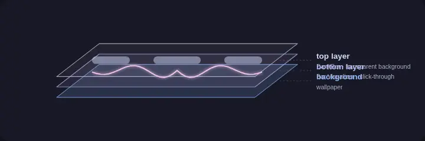

# Contributing

How the pieces fit together, and how to change them. For installing and using the visualizers, see the [README](README.md).

## Words and decisions

- [GLOSSARY.md](GLOSSARY.md) names the parts: the Bar Visualizer, the Lock Ring, a Kick, a Shockwave, the Aura, the Dial and so on. Use those names in code, comments, docs and PRs.
- [docs/adr/](docs/adr/) records the decisions that are hard to reverse, such as why the Lock Ring is a DMS plugin and why both visualizers read one `config.json`.

## Where things live

| Path | What it is |
| --- | --- |
| `shell.qml` | The Bar Visualizer: a Quickshell config, one surface per screen |
| `shaders/viz.frag` | The Bar Visualizer's look |
| `audio/AudioPipeline.qml` | The shared audio pipeline: follows the Active Player, runs cava, detects Kicks |
| `lock-ring/` | The Lock Ring plugin (`LockRing.qml`, `LockAudio.qml`, `LockLyrics.qml`, `plugin.json`) |
| `docs/` | The live demo (GitHub Pages), plus the plain-JS modules both visualizers and the demo import |
| `docs/kick.mjs` | The one Kick detector |
| `docs/config.mjs` | The defaults of every `config.json` key |
| `docs/bar-ribbons.mjs` | The Bar Visualizer's Ribbons: each one's height and color at any x across the bar, and the Shockwaves crossing it |
| `docs/bar-words.mjs` | The Bar Visualizer's Lyric Words: each letter on its Ribbon, and their pop, flare and dissolve |
| `lyrics/` | The Bar Visualizer's Lyric Words in QML: asks DMS's socket for lyrics (`BarLyrics.qml`), draws them (`LyricWordsLayer.qml`) |
| `docs/lyric-words.mjs` | The one Lyric Words module: which words of the Lyric Line show when |
| `docs/lock-ring/` | The Lock Ring's shader (`ring.frag`) and its modules (`ring.mjs`, `kicks.mjs`, `hands.mjs`, `clock.mjs`, `lyrics.mjs`: where its Lyric Words sit and how they look) |
| `packaging/aur/` | The two Arch packages' PKGBUILDs |
| `assets/` | The README's animations: the generated SVGs, the animated WebPs rendered from them, and both scripts |
| `tests/` | `node --test` suites |
| `harness/` | The replay harness: measures a visualizer on a recorded input (see Measuring) |

GitHub Pages publishes only `docs/` and doesn't follow symlinks, so every file the demo needs lives there. `lock-ring/` links to them (`lock-ring/shaders/ring.frag`, `lock-ring/*.mjs`, `lock-ring/docs/`, `lock-ring/audio/`). Edit the files under `docs/` and `audio/`, not the links.

## Audio

Both visualizers capture audio with [cava](https://github.com/karlstav/cava), set up in `audio/AudioPipeline.qml`:

- 32 log-spaced bands from 30 Hz to 14 kHz, at 60 fps
- mono, raw ASCII output, `noise_reduction=8`: light smoothing on purpose, so transients punch
- the source is the `.monitor` of the sink the Active Player plays to, falling back to the newest playing stream, then the default output

The pipeline writes cava's config to `$XDG_RUNTIME_DIR/bar-visualizer-cava.conf` for the Bar Visualizer, and to `$XDG_RUNTIME_DIR/lock-ring-cava.conf` for the Lock Ring. The command it runs is its `captureCommand`; whatever runs there, `parseBands` in `docs/kick.mjs` turns its lines into bands, and the rest of that module turns the bands into Kicks.

## Layers

<p align="center"></p>

The Bar Visualizer is a Wayland layer surface on the `bottom` layer (namespace `bar-visualizer`): click-through (an empty input mask), ignoring exclusive zones, and sized and inset exactly like the DankBar. The DMS bar draws on the `top` layer, so with a transparent bar background the Bar Visualizer shows through. With a maximized window on a monitor's active workspace, it drops its gap and rounding together with the bar, by the same rule DMS uses.

The Lock Ring can't work that way: while the screen is locked, only DMS's own surfaces are visible. So it's a DMS plugin drawn inside the lock screen ([ADR 0001](docs/adr/0001-lock-ring-runs-inside-dms.md)).

## Shaders

Qt loads compiled shaders (`.qsb`). After editing one, recompile it.

**Bar Visualizer** (`shaders/viz.frag`): run `./install.sh --no-service`, or

```sh
/usr/lib/qt6/bin/qsb --glsl "100 es,120,150" --hlsl 50 --msl 12 -o shaders/viz.frag.qsb shaders/viz.frag
```

Then restart it: `systemctl --user restart bar-visualizer`. Qt caches the compiled shader for the life of the process, so hot reload doesn't pick it up.

**Lock Ring** (`docs/lock-ring/ring.frag`): run `./install-lock.sh`, or

```sh
/usr/lib/qt6/bin/qsb --glsl "100 es,120,150" --hlsl 50 --msl 12 -o lock-ring/shaders/ring.frag.qsb lock-ring/shaders/ring.frag
```

Then `dms restart`.

The Lock Ring's shader mirrors functions and constants from the Lock Ring's modules. `tests/lock-constants.test.mjs` checks the constants match, so change both sides together. It also holds `lyrics.mjs`, which lays the Lyric Words on the strands and Hands and colors them as `ring.frag` does, to `ring.frag`'s inline numbers. Likewise the Bar Visualizer's shader, and the demo's port of it, mirror the Ribbon shape and color in `docs/bar-ribbons.mjs`, checked by `tests/bar-constants.test.mjs`.

Colors are Catppuccin Mocha: the `palette()` cycle and the `LAVENDER` / `MAUVE` / `PINK` / `BLUE` constants in each shader.

## The live demo

`docs/index.html` is the [live demo](https://dotmortis.github.io/dms-bar-visualizer/).

- **Bar view:** it carries its own GLSL ES port of `shaders/viz.frag`. Mirror shader changes there.
- **Lock Ring view** (`#ring`): nothing to mirror. It fetches the plugin's own `ring.frag` and converts it to GLSL ES as the page loads (`docs/webgl.mjs`), and imports the Lock Ring's modules. Only the Digital Time is drawn twice: in `LockRing.qml` and in the demo's canvas.
- **Kicks:** not mirrored either. The demo imports `docs/kick.mjs`, as the audio pipeline does.

Browsers don't load module scripts over `file://`, so to run the demo locally, serve the directory and open http://localhost:8000:

```sh
python3 -m http.server -d docs
```

## Tests

```sh
node --test
```

Needs only node, nothing to install. Besides the Lock Ring's modules, the install scripts and the packages, it runs a replay suite that holds the Kick detector to account. The suite plays real cava output, recorded from synthesized tracks with known kick onsets, through `docs/kick.mjs`. It fails when a track gets more missed, doubled or stray Kicks, or a later median Kick, than its budget allows, and prints those numbers per track for the default and a sensitive setting. Other tests check that Kicks and their power don't depend on the volume, that Kicks come back soon after a 12 dB drop and after a cava restart, and that `kickLowHz` and `kickHighHz` select the bands cava puts those frequencies in.

With Qt's `qml` runner installed (`qt6-declarative`), `tests/qml-modules.test.mjs` also loads every `.mjs` the QML imports through Qt's own JS engine. That engine rejects some syntax node accepts, object spread `{ ...x }` among it, and a module it rejects takes the whole plugin down with it. Without `qml` that test is skipped.

`tests/fixtures/record.py` synthesizes and records the tracks. It needs cava, numpy and real time; its header says how to re-record them or add one:

```sh
python3 tests/fixtures/record.py              # list the scenarios
python3 tests/fixtures/record.py all          # re-record all of them (about 4 minutes)
```

## Measuring

```sh
harness/run music                      # the Bar Visualizer on the reference track: CPU, frames, GPU, profile
harness/run --cpu-only music           # CPU alone
harness/run --commit v0.10.0 music     # the same for another commit
harness/run --check-kicks music        # check the replayed input reaches the Kick detector
harness/run silence_paused             # one of the three Silence cases
```

| Scenario | Band stream | Active Player |
| --- | --- | --- |
| `music` | the reference track | playing it ("Steady House") |
| `silence_no_player` | cava's silence | none |
| `silence_paused` | cava's silence | paused |
| `silence_playing` | cava's silence | playing a silent track ("Silence") |

The Active Player is a stand-in, `harness/player`: an MPRIS player on the run's own session bus, the only player there, so the visualizer takes it as the Active Player. While it plays, its position follows the replayed track (both start at the run's epoch, and it announces each loop's wrap with `Seeked`); paused, the position holds. `harness/run` fails a run if the visualizer never read it. It runs beside the bus, outside what's measured, as your player would. To drive it by hand during a run, point `playerctl -p harness play|pause` at the run's bus (`DBUS_SESSION_BUS_ADDRESS=$(cat /tmp/bvh.*/bus.addr)`, the run's runtime dir). Cava's silence is what cava prints when nothing plays: 5 s of all-zero frames, then nothing.

The replay harness runs the Bar Visualizer as it ships, in its own `qs`, but in place of cava it replays a recorded band stream from `tests/fixtures` (the reference track, `steady_house`). After a warm-up it measures whole loops of the track and prints CPU as % of one core, as htop shows it, for `qs`, its capture and every process they start together. The run gets its own runtime dir, config dir (every setting at its default), cache and session bus, so it never sees the live visualizers, DMS, your players or your `config.json`; it does show the visualizer on the desktop while it runs. `--check-kicks` runs the tree's audio pipeline on the same input and checks it fires the Kicks the replay tests expect for the track, loop by loop. `harness/run --help` lists the options.

It isn't a test and isn't part of `node --test` (only its Kick comparison, the stand-in player and the parsing of the measures below are, the player skipped without python-dbus): CPU depends on the machine and what else runs on it, so compare runs made back to back on an idle desktop. It needs Quickshell, a systemd user session with cgroup v2, `dbus-run-session`, `busctl`, node, python3 with python-dbus and python-gobject, and `qsb`; for the profile, `perf`.

Besides CPU, every run measures, over the same window (all of it in `result.json`):

| Line | What | From |
| --- | --- | --- |
| `frames` | frames rendered, per window, and how many came late: more than 1.5 refreshes (25 ms at 60 Hz) after the frame before, so the display showed the old one again; and how many refreshes those missed in all. A pause over 250 ms is the scene at rest (Qt renders nothing while nothing moves), counted apart, not as late. | Qt's render loop log (`QSG_RENDER_TIMING=1`) in `qs.log`, against the display's refresh from `hyprctl -j monitors` (the slowest monitor's if they differ; 60 Hz without Hyprland) |
| `gpu frame time` | the GPU's time per frame: mean, 95th percentile, worst | Qt's GPU timestamp queries (`QSG_RHI_PROFILE=1`), same log; each reading lags a frame or two |
| `gpu busy` | % of the GPU's render engine the run kept busy | the DRM driver's per-client counters in `/proc/<pid>/fdinfo` (xe, i915, amdgpu) |
| `profile` | where the CPU time goes: QML's JS engine (and its JIT), Qt Quick, Quickshell and the rest of `qs`'s gui thread, the render thread's scene graph and its GPU driver, `qs`'s other threads, the capture, `pactl`, the shells `qs` starts. Self time, user space only, by thread name and library. | `perf record` of every process in the run, in the window only |

The profile is kept: `perf.data` (with `perf-<pid>.map`, the names QML's JIT gave its code) and `profile.txt` (the parts, then `perf report` by thread and library, then by symbol). For call stacks open `perf.data` in a viewer: [hotspot](https://github.com/KDAB/hotspot) (an AppImage works), or `perf report -i perf.data` (`--debuginfod` fetches the Qt libraries' symbols; to name the JIT's code, copy `perf-<pid>.map` back to `/tmp` first). With [inferno](https://github.com/jonhoo/inferno) on PATH a run also writes `profile.svg`, a flame graph. perf must start `qs` (`kernel.yama.ptrace_scope` 1 lets it attach to nothing else), and at `kernel.perf_event_paranoid` 2 it samples user space only, so the kernel's share (system time in the `cpu` line) isn't in the profile.

These measures cost something themselves: the render loop's log and perf's sampling put about half a point of a core on the `cpu` line (2.3 % against 2.9 % for `music` here, mostly system time). Compare runs of the same kind; `--cpu-only` measures CPU alone.

## The README's animations

The animations in `assets/` are generated. `assets/generate.mjs` draws them as animated SVGs, and
`assets/render.mjs` renders those to the animated WebPs the README shows. The SVGs' glow filters
keep a browser's CPU busy for as long as the page is open; the WebPs don't. Change
`assets/generate.mjs`, then run both (`render.mjs` needs Chromium or Chrome, and ffmpeg with
libwebp):

```sh
node assets/generate.mjs
node assets/render.mjs
```

Each WebP is one loop of its SVG's main animation, so the SVGs' slower hue cycle and wallpaper
drift hold still in it.

| File | What it shows |
| --- | --- |
| `hero.webp` | Both visualizers on one synthetic 120 bpm loop that builds to a drop |
| `bar-anatomy.webp` | The Bar Visualizer with its parts labeled |
| `ring-anatomy.webp` | The Lock Ring with its parts labeled |
| `layers.webp` | The layer diagram above |

The Bar Visualizer is re-created from `shaders/viz.frag`. The Lock Ring is drawn from the plugin's own modules in `docs/lock-ring/*.mjs`, so its Ribbons, Shockwaves, Hour Points, Hands and Digital Time move as on the lock screen; only the glow is approximated with SVG filters. Keep each WebP around 1 MB or less, so the README loads quickly (`QUALITY=60 node assets/render.mjs` makes them smaller).

## Releases

Note every user-visible change in [CHANGELOG.md](CHANGELOG.md) under `[Unreleased]`, following [Keep a Changelog](https://keepachangelog.com/en/1.1.0/).
