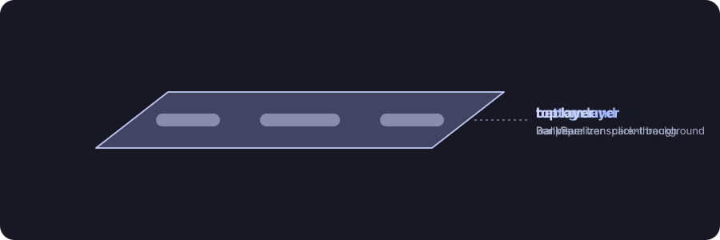

<div align="center">

<a href="https://dotmortis.github.io/dms-bar-visualizer/"></a>

<br>

**Music visualizers for [DankMaterialShell](https://github.com/AvengeMedia/DankMaterialShell) on Hyprland: one behind the top bar, one on the lock screen.**

[](https://hyprland.org)
[](https://quickshell.org)
[](https://catppuccin.com)
[](https://dotmortis.github.io/dms-bar-visualizer/)
[](CHANGELOG.md)
[](LICENSE)

</div>

Two visualizers that react to whatever is playing, in Catppuccin Mocha:

- the **Bar Visualizer**, behind the DankBar, sized and inset like the bar
- the **Lock Ring**, on the lock screen: a circular spectrum around an analog and digital clock

Install either one, or both. Neither touches the other, and DMS itself isn't modified, so DMS updates can't break them.

Try them in your browser first: the **[live demo](https://dotmortis.github.io/dms-bar-visualizer/)** runs the real shaders on a demo beat, a synth loop, your microphone or an audio file, with a slider for every setting. Its **[Lock Ring view](https://dotmortis.github.io/dms-bar-visualizer/#ring)** shows the Lock Ring.

## What it looks like

### Bar Visualizer

<p align="center"></p>

Neon **Ribbons** shaped by the spectrum swing around the bar's center line, inside a soft **Aura** that grows with the music. On every **Kick**, a **Shockwave** runs out from the center with a **Center Punch** where it starts and a **Spray** of sparks that streak and bounce. Hard Kicks flash the **Haze** across the bar. **Treble Sparks** twinkle with the treble.

With a song that has timed lyrics, the words of the line being sung appear as **Lyric Words**, each as it is sung, in a row on a Ribbon: the line's first word at a random spot, the rest after it. They ride its wave gently, glow in its color and pop in with a flash, harder on a Kick. A passing Shockwave makes them flare and split into colored copies. After the line ends it lingers a moment, then slowly dissolves while the next line already comes in. The lyrics come from DMS 2.0 or later ([`lyrics`](#configuration)).

### Lock Ring

<p align="center"></p>

Soft neon **Ribbons** wave outward from the **Dial**, which swells with the music, in round curves. A symmetric **Aura** glows both ways around the Dial. In silence the ribbon keeps breathing as a thin, faint wave.

On every Kick, a ragged, flickering **Shockwave** tears out from the center, carrying **Beads** of light. It's calm on a soft Kick and torn wide on a hard one. As its front passes, the Ribbons surge, the 12 **Hour Points** flash and the **Digital Time** splits into lavender, mauve and blue copies. The **Hands** swing with the bass, mids and treble and flash on the Kick itself, but always show the true time. The Lock Ring has no Haze.

**Lyric Words:** while a song with lyrics timed to it plays, its words appear around the Lock Ring as they are sung, each at a random spot, mostly on a Ribbon (bent along its curve, riding its wave), about one in three on a Hand (lying along it, turning with it). They glow in the color there, pop in with a flash, harder on a Kick, and split and flare like the Digital Time when a Shockwave crosses them. The words of a line pile up and dissolve together at its end; pause freezes them, a seek or a new track clears them. Songs without timed lyrics look as before. The lyrics are DMS's own, so this needs DMS v2.0 or later; turn it off with `lockRing.lyrics`. While it's on, DMS sends the playing track's title, artist and album to its lyrics providers on the lock screen, even with DMS's own Lyrics setting off.

## How it works

- **Follows the Active Player.** Both visualizers listen to the MPRIS player DankBar shows (same selection rules) and capture whichever output *that* player plays to. Spotify on Bluetooth while the default output is HDMI just works. With no player, they fall back to the newest playing stream, then the default output.
- **One Kick per hit, at any volume.** A Kick fires when a band in the kick range jumps well above its recent level. Harder hits make bigger Shockwaves, and up to 8 play at once.
- **One capture for all screens.** Every monitor's Bar Visualizer, and every monitor's Lock Ring, runs from one capture, so all screens pulse together. The Lock Ring captures only while the screen is locked.
- **Layering.** The Bar Visualizer is a click-through surface behind the DankBar. With a transparent bar, it shows through.

  <p align="center"></p>

## Requirements

- Hyprland
- DankMaterialShell: any version with a top bar for the Bar Visualizer, 2.x for the Lock Ring. The Bar Visualizer's Lyric Words need DMS 2.0 or later running; without it, the bar works as before, just without them
- PipeWire or PulseAudio
- Quickshell, cava, libpulse and qt6-shadertools. On Arch:

  ```sh
  sudo pacman -S --needed quickshell cava libpulse qt6-shadertools
  ```

  The Arch packages below pull these in for you.

## Install

> [!TIP]
> Piping a script into `bash` runs it without showing it to you. They're short, so read them first if you like: [install-arch.sh](install-arch.sh), [install-lock-arch.sh](install-lock-arch.sh), [install.sh](install.sh), [install-lock.sh](install-lock.sh).

### Arch Linux (recommended)

Each visualizer is a real pacman package, built locally with `makepkg` from [`packaging/aur`](packaging/aur), so pacman tracks every file. The scripts install `base-devel` and `git` if they're missing.

**Bar Visualizer** (`dms-bar-visualizer-git`):

```sh
# install, and update to the latest commit
curl -fsSL https://raw.githubusercontent.com/dotMortis/dms-bar-visualizer/main/install-arch.sh | bash
# uninstall
curl -fsSL https://raw.githubusercontent.com/dotMortis/dms-bar-visualizer/main/install-arch.sh | bash -s -- --uninstall
```

It installs to `/usr/share/dms-bar-visualizer`, registers the Quickshell config `bar-visualizer` and enables the systemd user service `bar-visualizer`. Add `--no-service` (after `bash -s --`) to skip the service and run it yourself with `qs -c bar-visualizer`. It also removes an earlier `install.sh` setup, which would otherwise shadow the package.

**Lock Ring** (`dms-lock-visualizer-git`):

```sh
# install, and update to the latest commit
curl -fsSL https://raw.githubusercontent.com/dotMortis/dms-bar-visualizer/main/install-lock-arch.sh | bash
# uninstall
curl -fsSL https://raw.githubusercontent.com/dotMortis/dms-bar-visualizer/main/install-lock-arch.sh | bash -s -- --uninstall
```

It installs the plugin into DMS's system plugin dir, `/etc/xdg/quickshell/dms-plugins/lockRing`, and removes a link left by `install-lock.sh`, which would otherwise shadow the package. Run `dms restart` after installing, updating or uninstalling.

From a clone, run `./install-arch.sh` or `./install-lock-arch.sh` with the same options.

### Other distros, or hacking on it

**Bar Visualizer:**

```sh
# install, and update
curl -fsSL https://raw.githubusercontent.com/dotMortis/dms-bar-visualizer/main/install.sh | bash
# uninstall
curl -fsSL https://raw.githubusercontent.com/dotMortis/dms-bar-visualizer/main/install.sh | bash -s -- --uninstall
```

Piped like this, it checks the repo out to `~/.local/share/dms-bar-visualizer` (or updates it there) and runs from that checkout. To hack on it, clone wherever you like and run `./install.sh` there instead. It compiles the shader, links the checkout to `~/.config/quickshell/bar-visualizer` and enables the `bar-visualizer` systemd user service. Use `--no-service` to skip the service and run `qs -c bar-visualizer` yourself.

**Lock Ring:** this one needs a clone, because `install-lock.sh` links the plugin from it. It can't be piped.

```sh
git clone https://github.com/dotMortis/dms-bar-visualizer && cd dms-bar-visualizer
./install-lock.sh               # install
./install-lock.sh --uninstall   # uninstall
```

It compiles the Lock Ring's shader (it needs `qsb`, from qt6-shadertools) and links `lock-ring/` into your DMS plugin dir as `~/.config/dms/plugins/lockRing`. To update, see [Updating](#updating). Run `dms restart` after installing or uninstalling.

## Set up

### Set up the Bar Visualizer

1. **Make the bar transparent:** **DMS Settings → Dank Bar → Transparency = 0**. The Bar Visualizer draws behind the bar, so an opaque bar hides it.
2. **Match the bar's geometry:** set `barThickness`, `spacing` and `radius` in `~/.config/bar-visualizer/config.json` to your DankBar's (see [Configuration](#configuration)). The file appears on first start. `hyprctl layers` shows the `dms:bar` surface, whose height is `barThickness + spacing`.
3. **Check it runs:** play some music. It should move behind the bar. If it doesn't, see [Troubleshooting](#troubleshooting).

### Set up the Lock Ring

1. **Check DMS has it:** the Lock Ring is a desktop plugin, so DMS loads it on its own, with no toggle. If it doesn't show up under **DMS Settings → Plugins**, run `dms restart`.
2. **Add the widget:** **DMS Settings → Lock Screen → Add widget → Lock Ring**.
3. **Move the password field:** the Lock Ring and DMS's password field both start in the center of the screen. Under **DMS Settings → Lock Screen → Edit widgets**, drag the password field below the Lock Ring. You can move and resize the Lock Ring there too.
4. **Check it runs:** play some music and lock the screen.

## Configuration

Both visualizers read one file, `~/.config/bar-visualizer/config.json` ([why one file](docs/adr/0004-both-visualizers-read-one-config-json.md)). The Bar Visualizer creates it with the defaults on first start, and again if you delete it, which resets everything. Without the Bar Visualizer, the Lock Ring runs on the defaults; create the file by hand to change them.

- Keys you leave out, and values of the wrong type, fall back to their default. Unknown keys are ignored.
- A half-written or broken file is skipped: both visualizers keep their last good settings.
- The Bar Visualizer picks up changes as soon as you save. The Lock Ring picks them up at the next lock. It never writes the file.

```json
{
  "barThickness": 44,
  "spacing": 6,
  "intensity": 1.2,
  "lockRing": {
    "ringSize": 0.5
  }
}
```

| Key | Default | Used by | What it does |
| --- | --- | --- | --- |
| `barThickness` | `40` | Bar | DankBar body height. It depends on DMS inner padding and font/icon scale |
| `spacing` | `4` | Bar | DMS bar *spacing* (the gap around the bar) |
| `radius` | `12` | Bar | DMS corner radius |
| `followMaximize` | `true` | Bar | Mirror DMS's *maximize detection*: with a maximized window on a monitor's active workspace, drop the gap and rounding with the bar |
| `intensity` | `1.0` | both | Overall brightness |
| `speed` | `1.0` | both | Animation speed |
| `kickThreshold` | `0.4` | both | How far a band must jump above its recent level to fire a Kick, as a share (0 to 1) of the kick range's recent peak. Lower = more Kicks. From about 0.15 down, bass notes fire too |
| `kickDecay` | `6.0` | both | Higher = shorter impact |
| `kickLowHz` | `20` | both | Bottom of the frequency range that fires a Kick |
| `kickHighHz` | `90` | both | Top of that range. Raise both to hit on snares or claps instead of the kick drum |
| `kickCooldown` | `0.1` | both | Minimum seconds between Kicks, scaled by `speed`. `0` = no limit |
| `lyrics` | `true` | Bar | Show the Lyric Words of the playing song on the bar. Off with `false` |
| `bassStretch` | `1.4` | both | Above 1 spreads the bass wider: around the bar's center, so center widgets don't hide it, and around the Lock Ring's bottom |
| `lockRing.handWaves` | `1.0` | Lock Ring | How far the Hands swing with the music and on Kicks. `0` = straight Hands |
| `lockRing.ringSize` | `0.4` | Lock Ring | The widget's default size, as a share of the screen height. Resizing it under Edit widgets still works |
| `lockRing.intensityPercent` | `100` | Lock Ring | The Lock Ring's brightness, in percent of `intensity` |
| `lockRing.kickLowHzPercent` | `100` | Lock Ring | The bottom of the Lock Ring's kick range, in percent of `kickLowHz` |
| `lockRing.kickHighHzPercent` | `100` | Lock Ring | The top of the Lock Ring's kick range, in percent of `kickHighHz` |
| `lockRing.kickThresholdPercent` | `100` | Lock Ring | The Lock Ring's `kickThreshold`, in percent of it. Lower = more Kicks |
| `lockRing.kickCooldownPercent` | `100` | Lock Ring | The Lock Ring's `kickCooldown`, in percent of it. With `kickCooldown` at `0` it stays `0` |
| `lockRing.lyrics` | `true` | Lock Ring | Show the playing song's [Lyric Words](#lock-ring) on the Lock Ring (DMS v2.0+). Sends the track's title, artist and album to DMS's lyrics providers. Applies at once |

The bar's `lyrics` asks DMS for the playing track's lyrics over its socket ([why](docs/adr/0006-bar-visualizer-asks-dms-for-lyrics.md)). DMS then sends the track's title, artist and album to its lyrics providers, even with lyrics turned off in DMS's own settings: the switch here alone decides. If DankBar's Music widget shows lyrics too, the bar shows the same line twice; turn one of them off.

The `lockRing` settings apply to every Lock Ring at once, since all of them share one capture ([why](docs/adr/0002-lock-ring-settings-are-plugin-wide.md)). A `config.json` from before the `lockRing` section existed works as it is; add the section to change them.

The `…Percent` keys tune the Lock Ring apart from the bar without cutting it loose: each is a percentage of the base setting, the top-level key both visualizers read. `100` is the same as the bar, `150` half again as much, and a negative value counts as `0`. Retuning the base setting retunes both ([why](docs/adr/0005-lock-ring-tunes-shared-settings-as-percentages.md)). The Lock Ring has its own Kick detector, so with other kick percentages it fires on other hits than the bar.

Want to tune by eye first? The [live demo](https://dotmortis.github.io/dms-bar-visualizer/) has a slider for every key, with the names `config.json` uses, and **Export config.json** downloads the whole file.

## Updating

Run the same install command again. The Arch scripts always build the latest commit from GitHub, and the piped `install.sh` updates its own checkout. From a clone of your own, `git pull` first.

- **Bar Visualizer:** the scripts restart its service.
- **Lock Ring:** DMS keeps a loaded plugin in memory, so run `dms restart` to load the new version.
- **Lock Ring from a clone:** `install-lock.sh` links the checkout, but compiles the Lock Ring's shader (`ring.frag.qsb`) only when it runs. After pulling, run `./install-lock.sh` again, then `dms restart`. The same goes if you ran it from the Bar Visualizer's `~/.local/share/dms-bar-visualizer` checkout and that checkout got updated.

## Troubleshooting

**Bar Visualizer**

- **Nothing shows:** make sure the DankBar is transparent ([Set up](#set-up-the-bar-visualizer)) and the service runs: `systemctl --user status bar-visualizer`.
- **Nothing moves:** check `pgrep -a cava` and `cat $XDG_RUNTIME_DIR/bar-visualizer-cava.conf`. The `source=` line should be the `.monitor` of the output you hear audio from.
- **Logs:** with the service, `journalctl --user -u bar-visualizer -f`. Started by hand, run `qs -c bar-visualizer` in a terminal and watch its output.

**Lock Ring**

- **Not in the widget list:** run `dms restart`, then look for it under **DMS Settings → Plugins**.
- **An old version shows after an update:** run `dms restart`. From a clone, run `./install-lock.sh` again first ([Updating](#updating)).
- **The Lock Ring shows but doesn't move:** while the screen is locked, check `cat $XDG_RUNTIME_DIR/lock-ring-cava.conf`. The `source=` line should be the `.monitor` of the output you hear audio from.

## Limitations

- **Top bar only:** the Bar Visualizer doesn't support bottom or side bars yet.
- **One geometry for all screens:** a single bar geometry applies to every screen, and the Bar Visualizer shows on every monitor even if DankBar is disabled on some.
- **Player switching:** DMS doesn't expose which player it shows, so both visualizers re-implement its rules. If you switch players by hand in the DMS media popout, they won't follow.

## Changelog

See [CHANGELOG.md](CHANGELOG.md). Releases are tagged on [GitHub](https://github.com/dotMortis/dms-bar-visualizer/releases).

## Contributing

Shaders, the demo, the tests and the README's animations: see [CONTRIBUTING.md](CONTRIBUTING.md).
