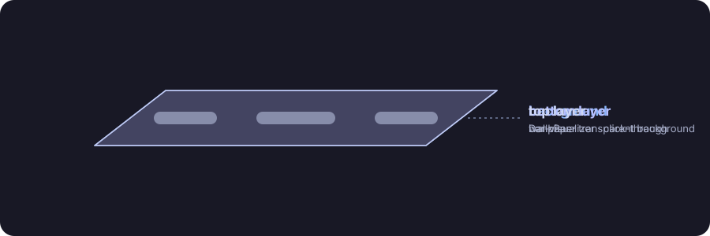

<div align="center">

<a href="https://dotmortis.github.io/dms-bar-visualizer/"></a>

<br>

**A shader-based audio visualizer that lives behind the top bar of [DankMaterialShell](https://github.com/AvengeMedia/DankMaterialShell) on Hyprland.**

[](https://hyprland.org)
[](https://quickshell.org)
[](https://catppuccin.com)
[](https://dotmortis.github.io/dms-bar-visualizer/)
[](CHANGELOG.md)
[](LICENSE)

</div>

Neon ribbons shaped by the spectrum, waves pushed outward by the music's energy, and on every kick a chromatic shockwave plus a spray of streaking particles, all in Catppuccin Mocha lavender.

It runs as its own small [Quickshell](https://quickshell.org) config. DMS itself isn't modified, so DMS updates can't break it.

> [!NOTE]
> The preview above is an SVG re-creation of `shaders/viz.frag` driven by a synthetic 120 bpm loop. For the real shader, try the **[live WebGL demo](https://dotmortis.github.io/dms-bar-visualizer/)**: it runs on a demo beat, a synth loop, your microphone or an audio file, with every tweakable on a slider.

## How it works

<p align="center"></p>

- **Layering:** a click-through Wayland layer surface on the `bottom` layer, sized and inset exactly like the DankBar. The DMS bar draws on the `top` layer, so with a transparent bar background the visualizer shows through.
- **Audio:** [cava](https://github.com/karlstav/cava) provides 32 frequency bands at 60 fps with light smoothing, so transients punch.
- **Follows the active player:** it tracks the MPRIS player DankBar shows (same selection rules) and captures the monitor of whichever output *that* player's stream plays to. Spotify on Bluetooth while the default output is HDMI just works. With no player, it falls back to the newest playing stream, then the default output.
- **Beat detection:** any band in the kick range (`kickLowHz` to `kickHighHz`) jumping above its own recent level fires a kick. The jump is measured against the range's recent peak, not on cava's output scale, which cava's auto-sensitivity keeps rescaling: kicks keep firing after a loud passage or a change in volume, and `kickThreshold` means the same at any volume. How hard a hit is next to the recent kicks scales its shockwave and particles, so accents stand out. Up to 8 kicks play on top of each other instead of cutting each other off.
- **Matches DMS's maximize detection:** with a maximized window on a monitor's active workspace, the visualizer drops its gap and rounding together with the bar.

## Requirements

- Hyprland
- DankMaterialShell (top bar)
- PipeWire or PulseAudio

On Arch:

```sh
sudo pacman -S --needed quickshell cava libpulse qt6-shadertools
```

## Install

> [!TIP]
> Piping a script from the internet into `bash` runs it without showing it to you. Both scripts are short; read them first ([install-arch.sh](install-arch.sh), [install.sh](install.sh)) if you like.

> [!IMPORTANT]
> Whichever way you install, make the bar background transparent: **DMS Settings → Dank Bar → Transparency = 0**.

### Arch Linux (recommended)

```sh
curl -fsSL https://raw.githubusercontent.com/dotMortis/dms-bar-visualizer/main/install-arch.sh | bash
```

Or from a clone: `git clone https://github.com/dotMortis/dms-bar-visualizer && cd dms-bar-visualizer && ./install-arch.sh`.

The script builds a real pacman package (`dms-bar-visualizer-git`) from [`packaging/aur`](packaging/aur/dms-bar-visualizer-git/PKGBUILD) with `makepkg`, so pacman tracks every file. It:

1. installs `base-devel` and `git` if they're missing, and pulls in dependencies through pacman
2. installs to `/usr/share/dms-bar-visualizer` and registers the Quickshell config as `bar-visualizer`
3. cleans up a previous `install.sh` setup, which would otherwise shadow the package
4. enables the systemd user service (skip with `--no-service`, then run `qs -c bar-visualizer`)

Run it again to update to the latest commit. To remove it, pass `--uninstall` (piped: `... | bash -s -- --uninstall`).

### Other distros, or hacking on it

```sh
curl -fsSL https://raw.githubusercontent.com/dotMortis/dms-bar-visualizer/main/install.sh | bash
```

Piped like this, it checks the repo out to `~/.local/share/dms-bar-visualizer` (or updates it there) and runs from that checkout. To hack on it, clone wherever you like and run `./install.sh` from there instead.

The script:

1. compiles the shader
2. symlinks the repo to `~/.config/quickshell/bar-visualizer`
3. enables a systemd user service that starts with your graphical session

Use `--no-service` to skip autostart and run it yourself with `qs -c bar-visualizer`.

### Uninstall

```sh
curl -fsSL https://raw.githubusercontent.com/dotMortis/dms-bar-visualizer/main/install-arch.sh | bash -s -- --uninstall   # Arch package
curl -fsSL https://raw.githubusercontent.com/dotMortis/dms-bar-visualizer/main/install.sh | bash -s -- --uninstall        # source install
```

## Configuration

Settings live in `~/.config/bar-visualizer/config.json`. The visualizer creates it with the defaults on first start (and again if you delete it, which resets everything). Keys you remove from it fall back to their default. The visualizer picks up changes as soon as you save, no restart needed.

```json
{
  "barThickness": 44,
  "spacing": 6,
  "intensity": 1.2
}
```

| Property | Default | What it does |
| --- | --- | --- |
| `barThickness` | `40` | DankBar body height. It depends on DMS inner padding and font/icon scale. |
| `spacing` | `4` | DMS bar *spacing* (the gap around the bar) |
| `radius` | `12` | DMS corner radius |
| `followMaximize` | `true` | Mirror DMS's *maximize detection* |
| `intensity` | `1.0` | Overall brightness |
| `speed` | `1.0` | Animation speed |
| `kickThreshold` | `0.4` | How far a band must jump above its recent level to fire a kick, as a fraction (0 to 1) of the kick range's recent peak. Lower = more kicks |
| `kickDecay` | `6.0` | Higher = shorter impact |
| `kickLowHz` | `30` | Bottom of the frequency range that fires the kick (shockwave and particles) |
| `kickHighHz` | `90` | Top of that range. Raise both to hit on snares or claps instead of the kick drum |
| `kickCooldown` | `0.12` | Minimum seconds between kicks, scaled by `speed`. `0` = no limit (a kick can fire on every cava frame, up to 60 per second) |
| `bassStretch` | `1.4` | Above 1 spreads the bass (centre) wider, so it isn't hidden under centre widgets |

To find the right geometry, run `hyprctl layers`. The `dms:bar` surface height equals `barThickness + spacing`.

The defaults themselves live in the `Tweakables` block at the top of `shell.qml`. If the file is half-written or not valid JSON, the visualizer keeps its last good settings.

Want to tune by eye first? The [live demo](https://dotmortis.github.io/dms-bar-visualizer/) has a slider for every key.

### Shader

The look lives in `shaders/viz.frag`: palette, ribbons, shockwave and particles. After editing it, recompile with `./install.sh --no-service` or:

```sh
/usr/lib/qt6/bin/qsb --glsl "100 es,120,150" --hlsl 50 --msl 12 -o shaders/viz.frag.qsb shaders/viz.frag
```

Then restart the visualizer (`systemctl --user restart bar-visualizer`). Qt caches the compiled shader for the life of the process, so hot reload doesn't pick it up.

To change colours, edit the `palette()` cycle and the `LAVENDER` / `MAUVE` / `PINK` / `BLUE` constants.

### README animations and demo

The SVGs in `assets/` are generated. After tweaking `assets/generate.py`, run `python3 assets/generate.py`.

`docs/index.html` is the live demo (served by GitHub Pages). It carries a GLSL ES port of `shaders/viz.frag`, so mirror shader changes there.

Kick detection isn't mirrored: `docs/kick.mjs` is the one detector, and both `shell.qml` and the demo import it. It lives in `docs/` because Pages publishes only that directory. Browsers don't load module scripts over `file://`, so to run the demo locally, serve the directory and open http://localhost:8000:

```sh
python3 -m http.server -d docs
```

### Kick detection tests

A replay suite holds the kick detector to account. It plays real cava output, recorded from synthesized tracks with known kick onsets, through `docs/kick.mjs` and fails when a track gets more missed, doubled or stray kicks, or a later median kick, than its budget allows. It needs nothing but node, no install:

```sh
node --test
```

It prints those numbers per track for the default and a sensitive kick setting. Other tests check that the kicks and their power don't depend on the volume, and that kicks come back soon after a 12 dB drop and after a cava restart. A sine sweep recorded the same way checks that `kickLowHz` and `kickHighHz` select the bands cava puts those frequencies in. `tests/fixtures/record.py` synthesizes and records the tracks; its header says how to re-record them or add one (needs cava, numpy and real time).

## Changelog

See [CHANGELOG.md](CHANGELOG.md). Releases are tagged on [GitHub](https://github.com/dotMortis/dms-bar-visualizer/releases).

## Limitations

- **Top bar only:** bottom and side bars aren't supported yet.
- **One geometry for all screens:** a single bar geometry applies to every screen, and the visualizer shows on every monitor even if DankBar is disabled on some.
- **Player switching:** DMS doesn't expose which player it displays, so the visualizer re-implements the same rules. If you switch players by hand in the DMS media popout, the visualizer won't follow.

## Troubleshooting

- **Nothing moves:** check `pgrep -a cava` and `cat $XDG_RUNTIME_DIR/bar-visualizer-cava.conf`. The `source=` line should be the `.monitor` of the output you hear audio from.
- **Logs:**
  - with the service: `journalctl --user -u bar-visualizer -f`
  - started by hand: run `qs -c bar-visualizer` in a terminal and watch its output
